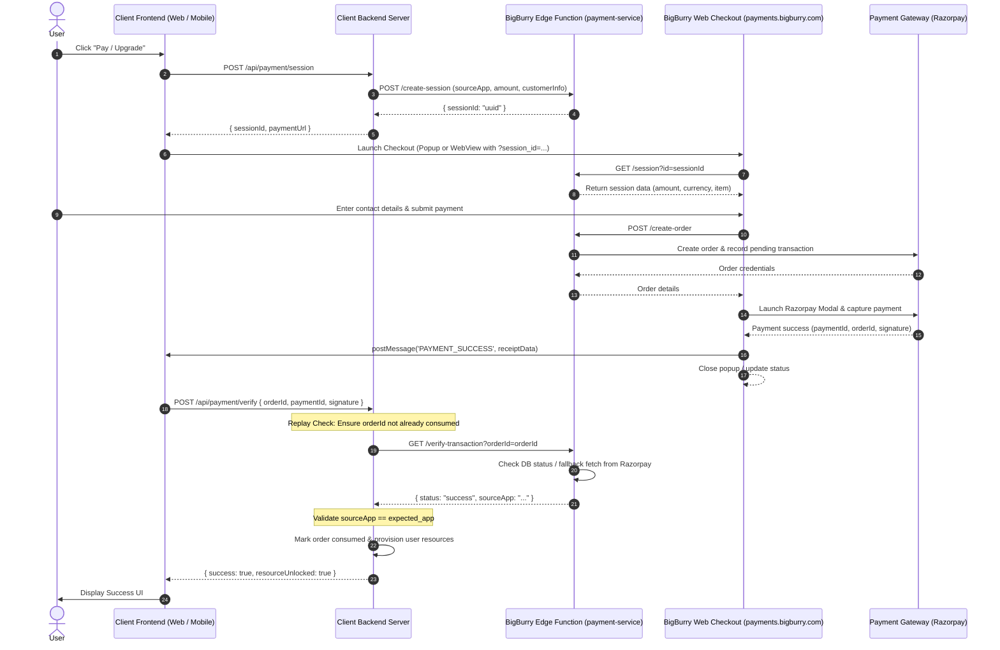

# BigBurry Payments Integration Guide

The **BigBurry Centralized Payment Gateway** (`payments.bigburry.com`) provides a secure, unified payment infrastructure across all BigBurry ecosystem applications (such as Gathent, Quick Website, and QuickVote). It abstracts payment gateways (e.g., Razorpay, Stripe) so client applications can collect payments without touching sensitive financial credentials, managing PCI-DSS compliance, or bundling redundant gateway SDKs.

---

## 1. System Architecture & Transaction Flow

The integration operates across four distinct entities:
1. **Client Frontend (Web / Mobile)**: The user interface that triggers the checkout flow and receives client callbacks.
2. **Client Backend Application**: Your server that orchestrates order creation, validates security boundaries, and fulfills digital purchases.
3. **BigBurry Central Gateway**: Comprising the Supabase Edge Function (`payment-service`) and hosted checkout web portal (`payments.bigburry.com`).
4. **Upstream Payment Provider**: The banking gateway (Razorpay / Stripe) executing authorization and settlement.



---

## 2. Core Environments & Endpoints

| Resource | Environment | URL / Base Endpoint |
| :--- | :--- | :--- |
| **Edge Function (REST API)** | Production | `https://ppgmyyxzrlemjgegnbou.supabase.co/functions/v1/payment-service` |
| **Edge Function (Local Dev)** | Local | `http://localhost:54321/functions/v1/payment-service` |
| **Web Checkout Portal** | Production | `https://payments.bigburry.com` |
| **Web Checkout Portal (Local)** | Local | `http://localhost:5173` |

---

## 3. Step 1: Create a Secure Payment Session (Server-Side)

> [!CAUTION]
> **Never create payment sessions directly from the client browser.** A client-side session call allows users to manipulate the payment `amount` or tamper with the `sourceApp`. Always create sessions from your secure backend server.

### Request Specification
- **Method:** `POST`
- **Path:** `/create-session`
- **Headers:** `Content-Type: application/json`

#### Request Body
```json
{
  "sourceApp": "quick-website",
  "amount": 499.00,
  "currency": "INR",
  "productName": "Pro Election Upgrade",
  "customerName": "Jane Doe",
  "customerEmail": "jane@example.com"
}
```

| Parameter | Type | Required | Description |
| :--- | :--- | :--- | :--- |
| `sourceApp` | `string` | **Yes** | Unique identifier for your client application (e.g., `gathent`, `quick-website`, `quickvote`). Used for cross-app isolation. |
| `amount` | `number` | **Yes** | Total monetary value to charge (in whole units, e.g., `499.00` for ₹499.00). |
| `currency` | `string` | No | Currency code (`INR`, `USD`). Defaults to `INR`. |
| `productName` | `string` | **Yes** | Name or brief description of the item or subscription displayed to the payer. |
| `customerName` | `string` | No | Full name of the customer (prefills checkout form). |
| `customerEmail`| `string` | No | Email address for payment receipt notifications. |

#### Response (200 OK)
```json
{
  "sessionId": "b8a5fc31-7b9e-4e8c-8c11-9a74992582bf"
}
```

Sessions are valid for **1 hour** (`expires_at = NOW() + 1 hour`).

---

### Backend Implementation Examples

#### Node.js / Express
```javascript
const axios = require('axios');

const BIGBURRY_SERVICE_URL = process.env.BIGBURRY_PAYMENT_SERVICE_URL 
  || 'https://ppgmyyxzrlemjgegnbou.supabase.co/functions/v1/payment-service/create-session';
const PAYMENTS_WEB_URL = process.env.PAYMENTS_WEB_URL || 'https://payments.bigburry.com';

app.post('/api/checkout/session', async (req, res) => {
  const { planId, user } = req.body;
  const chargeAmount = 499.00; // Determined securely server-side

  try {
    const response = await axios.post(BIGBURRY_SERVICE_URL, {
      sourceApp: 'my-service-app',
      amount: chargeAmount,
      currency: 'INR',
      productName: 'Annual Pro Plan',
      customerName: user.name,
      customerEmail: user.email,
    });

    const sessionId = response.data.sessionId;
    const checkoutUrl = `${PAYMENTS_WEB_URL}/?session_id=${sessionId}`;

    res.json({ sessionId, checkoutUrl });
  } catch (error) {
    console.error('Failed to create payment session:', error.response?.data || error.message);
    res.status(500).json({ error: 'Failed to initiate payment session.' });
  }
});
```

#### Python / Django
```python
import requests
from rest_framework.views import APIView
from rest_framework.response import Response
from rest_framework import status

GATEWAY_SESSION_URL = "https://ppgmyyxzrlemjgegnbou.supabase.co/functions/v1/payment-service/create-session"
PAYMENTS_WEB_URL = "https://payments.bigburry.com"

class CreatePaymentSessionView(APIView):
    def post(self, request):
        user = request.user
        amount = 1499.00 # Calculated server-side

        payload = {
            "sourceApp": "gathent",
            "amount": amount,
            "currency": "INR",
            "productName": "Election Pro License",
            "customerName": f"{user.first_name} {user.last_name}".strip() or user.username,
            "customerEmail": user.email,
        }

        try:
            resp = requests.post(GATEWAY_SESSION_URL, json=payload, timeout=10)
            resp.raise_for_status()
            session_id = resp.json().get("sessionId")

            return Response({
                "sessionId": session_id,
                "checkoutUrl": f"{PAYMENTS_WEB_URL}/?session_id={session_id}"
            }, status=status.HTTP_200_OK)
        except requests.RequestException as e:
            return Response({"error": f"Gateway unreachable: {str(e)}"}, status=status.HTTP_502_BAD_GATEWAY)
```

---

## 4. Step 2: Client-Side Checkout & Event Handling

Clients can integrate using either a **Web Popup** (standard for web apps) or an **In-App WebView** (standard for mobile apps).

### Pattern A: Web Frontend (Popup & `postMessage`)

1. Obtain `sessionId` from your backend.
2. Launch `https://payments.bigburry.com/?session_id=${sessionId}` in a centered popup window.
3. Register a `window.addEventListener('message')` handler.
4. Verify `event.origin` matches `https://payments.bigburry.com`.
5. Upon receiving `PAYMENT_SUCCESS`, dispatch the transaction identifiers to your backend to finalize the purchase.

```typescript
import React, { useEffect, useRef, useState } from 'react';

interface PaymentReceipt {
  paymentId: string;
  orderId: string;
  signature: string;
}

export const CheckoutButton: React.FC = () => {
  const [isProcessing, setIsProcessing] = useState(false);
  const popupRef = useRef<Window | null>(null);
  const pollTimerRef = useRef<NodeJS.Timeout | null>(null);

  useEffect(() => {
    const handleMessage = async (event: MessageEvent) => {
      // 1. Strict Origin Verification
      const allowedOrigins = [
        'https://payments.bigburry.com',
        'http://localhost:5173', // local dev
      ];
      if (!allowedOrigins.includes(event.origin)) return;

      // 2. Handle Success
      if (event.data?.type === 'PAYMENT_SUCCESS') {
        cleanupPopup();
        const { paymentId, orderId, signature } = event.data as PaymentReceipt & { type: string };
        
        try {
          // Submit receipt to your server for authoritative validation
          await confirmWithBackend({ paymentId, orderId, signature });
          alert('Payment Successful!');
        } catch (err: any) {
          alert(`Verification failed: ${err.message}`);
        } finally {
          setIsProcessing(false);
        }
      }

      // 3. Handle Failure
      if (event.data?.type === 'PAYMENT_FAILURE') {
        cleanupPopup();
        setIsProcessing(false);
        alert(`Payment Failed: ${event.data.errorMsg || 'Transaction cancelled.'}`);
      }
    };

    window.addEventListener('message', handleMessage);
    return () => {
      window.removeEventListener('message', handleMessage);
      cleanupPopup();
    };
  }, []);

  const cleanupPopup = () => {
    if (pollTimerRef.current) clearInterval(pollTimerRef.current);
    if (popupRef.current && !popupRef.current.closed) {
      popupRef.current.close();
    }
    popupRef.current = null;
  };

  const handleStartCheckout = async () => {
    setIsProcessing(true);

    try {
      // Fetch session from YOUR server
      const res = await fetch('/api/checkout/session', { method: 'POST' });
      const { checkoutUrl } = await res.json();

      // Launch popup
      const popup = window.open(
        checkoutUrl,
        'BigBurryCheckout',
        'width=520,height=760,menubar=no,toolbar=no,location=no,status=no'
      );

      if (!popup || popup.closed) {
        setIsProcessing(false);
        alert('Popup was blocked by your browser. Please allow popups for this site.');
        return;
      }

      popupRef.current = popup;

      // Detect if user abruptly closes the window
      pollTimerRef.current = setInterval(() => {
        if (popupRef.current && popupRef.current.closed) {
          cleanupPopup();
          setIsProcessing(false);
        }
      }, 800);
    } catch (err) {
      setIsProcessing(false);
      alert('Could not initialize payment session.');
    }
  };

  const confirmWithBackend = async (receipt: PaymentReceipt) => {
    const res = await fetch('/api/checkout/verify', {
      method: 'POST',
      headers: { 'Content-Type': 'application/json' },
      body: JSON.stringify(receipt),
    });
    if (!res.ok) {
      const errorData = await res.json();
      throw new Error(errorData.error || 'Server validation failed');
    }
  };

  return (
    <button onClick={handleStartCheckout} disabled={isProcessing}>
      {isProcessing ? 'Processing Payment...' : 'Pay with BigBurry'}
    </button>
  );
};
```

---

### Pattern B: Mobile Application (Flutter WebView)

For mobile applications (e.g., Flutter), display `payments.bigburry.com` within an in-app webview, listening for:
1. `postMessage` relayed via a JavaScript Channel (`PaymentChannel`).
2. URL query parameter changes (`?status=success&payment_id=...&order_id=...`).

```dart
import 'dart:convert';
import 'package:flutter/material.dart';
import 'package:webview_flutter/webview_flutter.dart';

class PaymentGatewayScreen extends StatefulWidget {
  final String sessionId;
  final Function(String orderId, String paymentId) onSuccess;
  final Function(String error) onFailure;

  const PaymentGatewayScreen({
    Key? key,
    required this.sessionId,
    required this.onSuccess,
    required this.onFailure,
  }) : super(key: key);

  @override
  State<PaymentGatewayScreen> createState() => _PaymentGatewayScreenState();
}

class _PaymentGatewayScreenState extends State<PaymentGatewayScreen> {
  late final WebViewController _controller;
  bool _isLoading = true;

  @override
  void initState() {
    super.initState();
    const gatewayBaseUrl = 'https://payments.bigburry.com';

    _controller = WebViewController()
      ..setJavaScriptMode(JavaScriptMode.unrestricted)
      ..setBackgroundColor(Colors.white)
      ..addJavaScriptChannel(
        'PaymentChannel',
        onMessageReceived: (JavaScriptMessage message) {
          try {
            final data = jsonDecode(message.message);
            if (data['type'] == 'PAYMENT_SUCCESS') {
              widget.onSuccess(data['orderId'], data['paymentId']);
              Navigator.of(context).pop();
            } else if (data['type'] == 'PAYMENT_FAILURE') {
              widget.onFailure(data['errorMsg'] ?? 'Payment failed');
              Navigator.of(context).pop();
            }
          } catch (_) {}
        },
      )
      ..setNavigationDelegate(
        NavigationDelegate(
          onUrlChange: (UrlChange change) {
            final uri = Uri.tryParse(change.url ?? '');
            if (uri == null) return;

            // Handle redirect fallback
            if (uri.queryParameters['status'] == 'success') {
              final paymentId = uri.queryParameters['payment_id'] ?? '';
              final orderId = uri.queryParameters['order_id'] ?? '';
              widget.onSuccess(orderId, paymentId);
              if (mounted) Navigator.of(context).pop();
            } else if (uri.queryParameters['status'] == 'failure') {
              final error = uri.queryParameters['error'] ?? 'Transaction failed';
              widget.onFailure(error);
              if (mounted) Navigator.of(context).pop();
            }
          },
          onPageFinished: (String url) {
            setState(() => _isLoading = false);
            // Bridge postMessage to Flutter JavaScriptChannel
            _controller.runJavaScript('''
              window.addEventListener('message', function(event) {
                if (event.origin !== '$gatewayBaseUrl') return;
                if (event.data && (event.data.type === 'PAYMENT_SUCCESS' || event.data.type === 'PAYMENT_FAILURE')) {
                  PaymentChannel.postMessage(JSON.stringify(event.data));
                }
              });
            ''');
          },
        ),
      )
      ..loadRequest(Uri.parse('$gatewayBaseUrl/?session_id=${widget.sessionId}'));
  }

  @override
  Widget build(BuildContext context) {
    return Scaffold(
      appBar: AppBar(title: const Text('Complete Payment')),
      body: Stack(
        children: [
          WebViewWidget(controller: _controller),
          if (_isLoading) const Center(child: CircularProgressIndicator()),
        ],
      ),
    );
  }
}
```

---

## 5. Step 3: Server-to-Server Verification (Critical Security Standard)

> [!IMPORTANT]
> **Client-side callbacks (`postMessage`) can be spoofed or intercepted.**
> Before unlocking paid resources, your backend **must perform 4 mandatory security checks**:
> 1. **Identifier Check:** Validate that `orderId` and `paymentId` are present and non-empty.
> 2. **Replay Defense:** Ensure this `orderId` has never been redeemed before in your database.
> 3. **Gateway Verification:** Call the BigBurry verification endpoint to verify that status is `success`.
> 4. **Application Isolation:** Validate that `sourceApp` matches your application name.

### Verification Endpoint Specification
- **Method:** `GET`
- **Path:** `/verify-transaction?orderId={providerOrderId}`
- **Headers:** `Accept: application/json`

#### Success Response (200 OK)
```json
{
  "status": "success",
  "sourceApp": "quick-website",
  "provider": "razorpay"
}
```

> [!NOTE]
> If a webhook delay occurs, the `/verify-transaction` endpoint automatically falls back to an upstream live check against Razorpay's API and reconciles the database status in real time.

---

### Backend Verification Implementation Example (Node.js)

```javascript
const axios = require('axios');

const VERIFY_URL = process.env.BIGBURRY_VERIFY_SERVICE_URL 
  || 'https://ppgmyyxzrlemjgegnbou.supabase.co/functions/v1/payment-service/verify-transaction';

app.post('/api/checkout/verify', async (req, res) => {
  const { orderId, paymentId, signature } = req.body;
  const user = req.user;

  // 1. Validate identifiers
  if (!orderId || !paymentId) {
    return res.status(400).json({ error: 'orderId and paymentId are required.' });
  }

  // 2. Replay attack check: Has this orderId been consumed?
  const existingOrder = await db.orders.findOne({ providerOrderId: orderId });
  if (existingOrder) {
    return res.status(409).json({ error: 'This payment order has already been consumed.' });
  }

  // Allow dev mocks during local E2E testing
  const isDevMock = process.env.NODE_ENV !== 'production' && orderId.startsWith('mock_order_');
  let verified = isDevMock;

  if (!isDevMock) {
    // 3. Query BigBurry Gateway with retries (up to 3 attempts)
    const maxRetries = 3;
    for (let attempt = 0; attempt < maxRetries; attempt++) {
      try {
        const verifyRes = await axios.get(`${VERIFY_URL}?orderId=${encodeURIComponent(orderId)}`, {
          timeout: 8000,
        });

        if (verifyRes.data?.status === 'success') {
          // 4. Verify sourceApp isolation
          if (verifyRes.data.sourceApp !== 'quick-website') {
            return res.status(403).json({ 
              error: `Cross-application payment mismatch: ${verifyRes.data.sourceApp}` 
            });
          }
          verified = true;
          break;
        }
      } catch (err) {
        if (err.response?.status === 404) {
          return res.status(404).json({ error: 'Order not found in BigBurry gateway.' });
        }
      }

      if (attempt < maxRetries - 1) {
        await new Promise((r) => setTimeout(r, 1500));
      }
    }
  }

  if (!verified) {
    return res.status(402).json({ error: 'Payment was not confirmed by the central gateway.' });
  }

  // 5. Store transaction record and provision features (Atomically)
  await db.transaction(async (trx) => {
    await trx.orders.insert({
      userId: user.id,
      providerOrderId: orderId,
      paymentId: paymentId,
      status: 'paid',
      createdAt: new Date(),
    });

    await trx.users.update({ id: user.id }, { isPro: true });
  });

  return res.json({ success: true, message: 'Account upgraded successfully!' });
});
```

---

## 6. Testing & Development Workflows

### Mock Testing in Development
The BigBurry Payments Web portal includes simulated test actions in development mode (`NODE_ENV !== 'production'`). When developing locally, you can bypass live bank charges:

1. **Trigger Mock Success:** The gateway dispatches:
   ```json
   {
     "type": "PAYMENT_SUCCESS",
     "paymentId": "mock_pay_123",
     "orderId": "mock_order_123",
     "signature": "mock_sig"
   }
   ```
2. Your server should permit `orderId.startsWith('mock_order_')` strictly when `NODE_ENV !== 'production'`.

### Running BigBurry Payments Locally
To test end-to-end payment flows locally against the repository:

1. **Start Edge Function:**
   ```bash
   cd services/payments-db
   supabase functions serve payment-service --no-verify-jwt
   ```
2. **Start Checkout Frontend:**
   ```bash
   cd apps/payments-web
   npm run dev
   ```
3. Set your client app environment variables:
   ```env
   PAYMENTS_WEB_URL=http://localhost:5173
   BIGBURRY_PAYMENT_SERVICE_URL=http://localhost:54321/functions/v1/payment-service/create-session
   BIGBURRY_VERIFY_SERVICE_URL=http://localhost:54321/functions/v1/payment-service/verify-transaction
   ```

---

## 7. Security & Compliance Checklist

- [x] **Zero Raw Card Data:** No PAN, CVV, or card expiry data touches client application servers.
- [x] **Secure Session Origin:** All sessions generated on the backend with restricted `sourceApp`.
- [x] **Strict Domain Whitelisting:** Client frontend validates `event.origin === 'https://payments.bigburry.com'`.
- [x] **Server-to-Server Re-Verification:** Client server calls `/verify-transaction` before releasing products.
- [x] **Anti-Replay Protection:** Unique database index on `providerOrderId` prevents double-spending.
- [x] **Tenant Sandboxing:** Client server verifies `sourceApp` matches its designated identifier.

